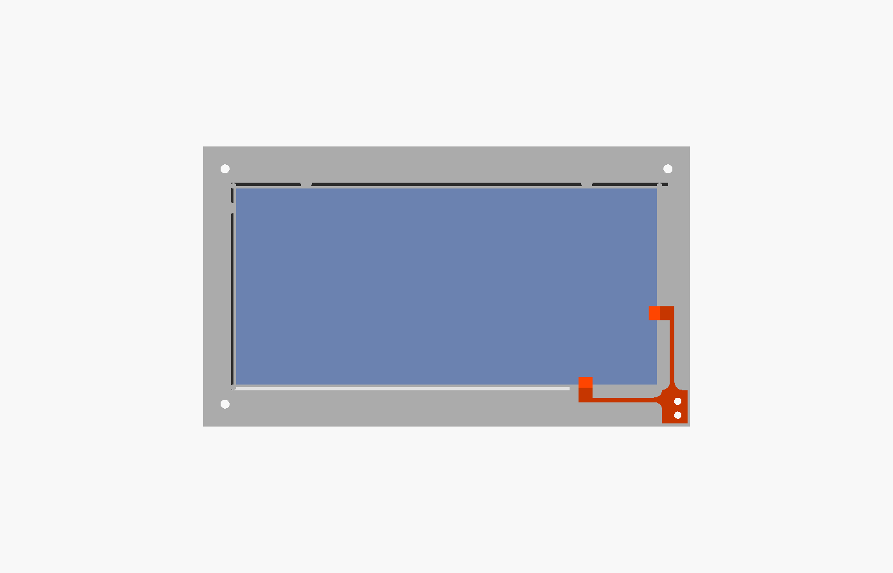
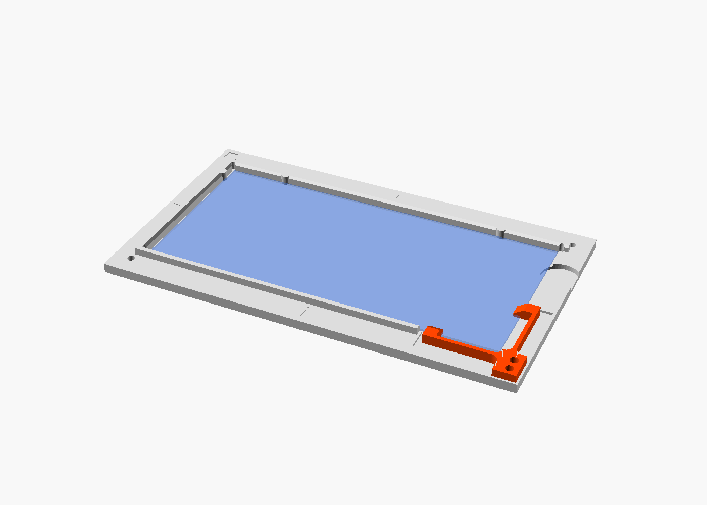
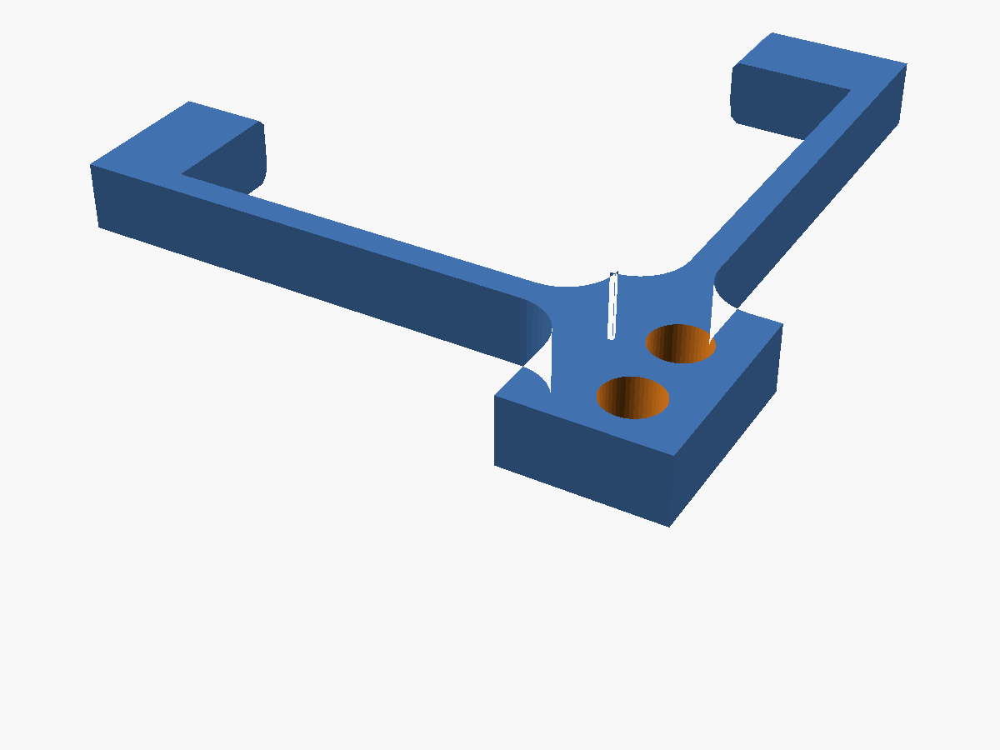
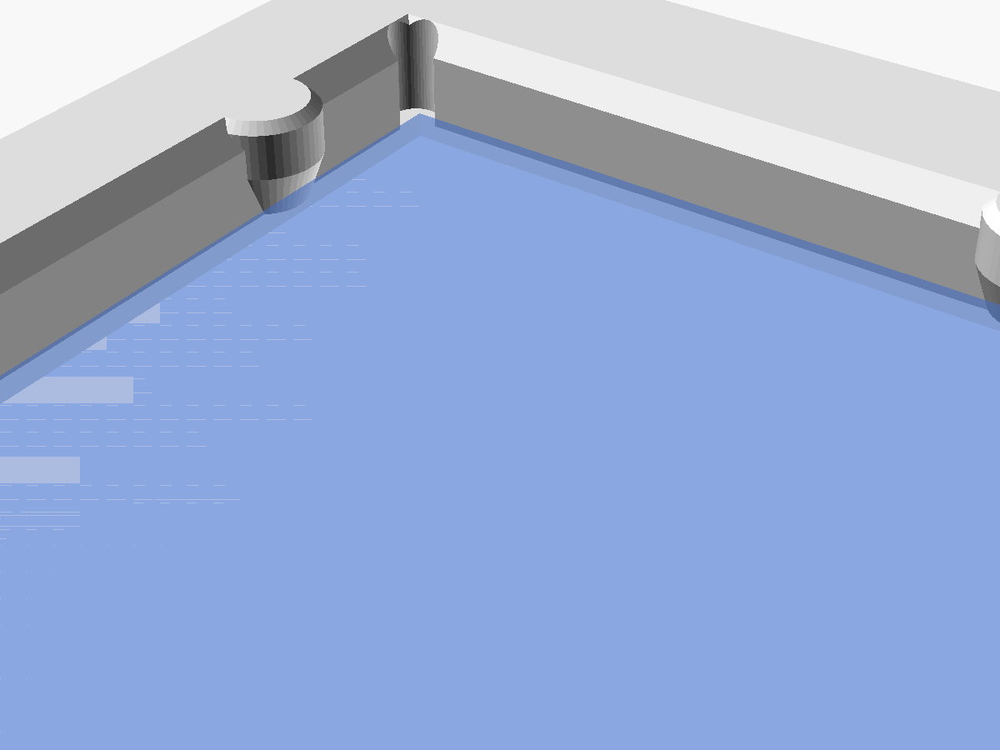
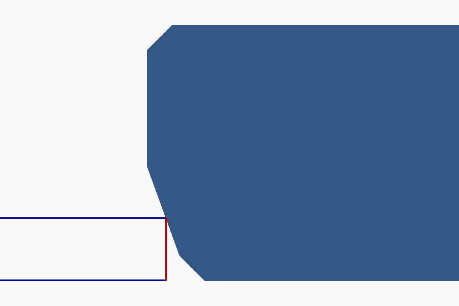
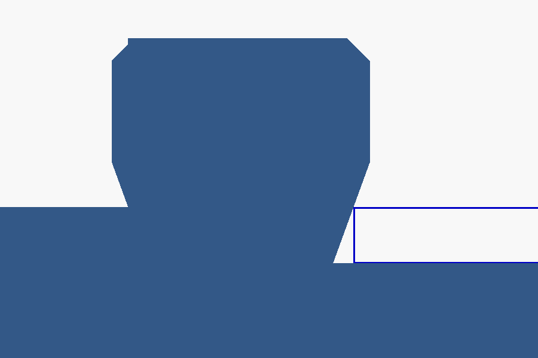

# 70×150 プレート固定治具 v2（3点固定・角バネ版）

仕様書：[docs/instructions/plate_70x150_jig_spec_v2.md](../../docs/instructions/plate_70x150_jig_spec_v2.md)

## 仮定値（未確認．実測したらパラメータを変えて再出力する）

| 項目 | 仮定値 | 変えるパラメータ |
|---|---|---|
| プレート厚さ | 1.0mm | `plate_t`（0.8〜2.0 で確認済み）．**角バネの高さも変わるので，ベースと角バネの両方を出し直す** |
| プレートの重さ | 鋼板 1mm 相当 0.8N（最も重い場合） | 計算のみ |
| 摩擦係数 | 0.3 | 計算のみ |
| 床の内寸 | ベース 174×100 が収まる | `base_l`，`base_w`（角バネの配置からこれが最小） |
| 床への固定 | MDF に M3．方法は未確定 | `hole_enable`，`hole_d`，`hole_inset` |
| 評価領域の端余白 | 3mm（爪を使う場合のみ関係） | `claw_overlap` |

## 仕組み

上から見て左上（−X・+Y）が基準角．プレートは 3 点の当たりに押し当てられて位置が決まる．

- 当たり：上辺（+Y）に 2 点（x＝±50），左辺（−X）に 1 点（y＝+28）．半径 2 の円柱で，プレート縁に線で当たる．
- 角バネ（別部品）：右下の角に M3 ねじ 2 本で留める．X 腕が右辺を左へ，Y 腕が下辺を上へ押す．合力が左上を向く．
- ガイド壁（左・上・下の 3 辺）はすきま 1mm で，位置決めには使わない．右端は出し入れ側で壁なし．








上：パッドの断面（X パッド，腕がプリロード分たわんだ状態），下：左辺の当たりの断面．枠がプレート．パッドと当たりの 5 か所すべてに返し（20° の逆テーパー）を付け，プレートの上の縁を斜め下へ押さえ込む．斜面は付けない（縁が斜面に乗ると押す力が上を向き，プレートが浮いて外れるため）．パッド下端の面取りは，一層目のはみ出しがプレート縁の下に入り込むのを防ぐ．

5 か所が押さえていれば，プレートが硬い限りどの角も浮かない（押さえの無い角を持ち上げると，反対側の押さえ点が床へめり込む向きに回る必要があるため）．薄くてたわむプレートで角が浮く場合は，ねじ頭で押さえる穴を追加する．

組立図では，角バネは自由状態（プレートが無いときの形）で描いている．パッドがプレートに 2.8mm 重なって見えるのがプリロードで，実物では腕がその分たわむ．

## 角バネの計算値（初期値，SCAD の echo と同じ）

PETG，E＝2.0GPa，2 本の腕は同じ寸法．片持ち梁で計算．

| 項目 | 値 |
|---|---|
| 腕 長さ×厚さ×高さ | 30 × 1.6 × 4（高さ＝plate_t＋3） |
| バネ定数 k＝3EI/L³ | 0.303 N/mm |
| プリロード | 2.8 mm |
| 押し付け力（各腕） | 0.85 N |
| 根元の応力（プリロード時） | 14.9 MPa |
| 根元の応力（入れるときの最大たわみ 3.6mm） | 19.2 MPa（上限 20） |
| 返し（20°）の張り出し | 0.29 mm |
| 返しの押し下げ力（各接点） | 0.31 N（＝押す力×tan20°） |
| 当たりの力：左辺 1 点 / 上辺 左・右 | 0.85 / 0.32・0.53 N |

- 寄せきれるか：Y 腕は，床の摩擦と左辺の当たりでの摩擦の合計に勝つ必要がある．返しがプレートを床へ押すので床の摩擦が増え，0.3×（0.8＋2×0.31）＝0.43N と 0.3×0.85＝0.26N の合計 0.69N．0.85N で余裕 1.2 倍と小さい．寄りきらないときは，手を離したあとプレートを軽く叩くか，左上へ指で寄せる．
- 3 点の力は，各腕が押す位置（X 腕 y＝−9.5，Y 腕 x＝+49.5）と当たりの位置のモーメントのつり合いから求めた．すべて正なので，プレートは 3 点に当たる．
- plate_t を変えると高さが変わり，力が変わる：0.8mm で 0.81N，2.0mm で 1.06N（応力は高さによらない）．

## 寸法（初期値）

| 部位 | 寸法 |
|---|---|
| ベース | 174 × 100 × 4 |
| ポケット | 152 × 72，深さ＝plate_t（プレート上面がベース上面と面一） |
| ガイド壁 | 厚さ 3，ベース上面から高さ 3，内側上端に面取り 1 |
| 当たり | 半径 2，壁から 1 突き出す |
| 角バネ | 取付ブロック 9 × 12，腕 30 × 1.6，パッド 5 幅，全高 4 |
| 返し（パッド 2 か所，当たり 3 点） | 斜面なし．当たり面は 20° の逆テーパーでプレートの上の縁に当たり，プレート上面＋0.8 まで張り出して（0.29）その上は鉛直．上端の角に 0.4 の面取り．パッドの下端は 0.4 の 45° 面取り |
| 当たり | 逆円錐．プレート上面の高さで半径 2，ポケット底で 1.64，上部 2.29 |
| 固定ねじ穴 | φ3.2，縁から 8．右下は角バネにかかるので出さない（3 個） |

## 造形

| 部品 | 材料 | 向き | 設定（Bambu Studio） |
|---|---|---|---|
| `plate_jig_base.stl` | PLA または PETG | 下面をベッドに，そのまま | 積層 0.2，ウォール 3，充填 20％以上，サポートなし |
| `plate_jig_spring.stl` | **PETG** | 下面をベッドに，そのまま（使うときの姿勢） | 積層 0.2，**ウォール 4 以上（腕 1.6mm がすべてウォールになる）**，**充填 100％**，サポートなし |

角バネをこの向きで印刷すると，曲げの応力が層の面内にかかり，層間を引きはがす向きには曲がらない．

## 組み立て

1. 角バネの取付ブロックを，ベース右下の凹みに入れる（すきま 0.15 で位置が決まる）．
2. M3×6 のねじ 2 本で留める（ベースの下穴 φ2.6 にセルフタップ）．力はほとんどかからないので軽く締める．
3. ベースを床（MDF）に M3 で留める．

## 使い方

- 入れる：
  1. プレートの右下の角（角バネ側）を先にポケットに入れ，右辺を X パッドに，下辺を Y パッドに当てる．
  2. プレートを右下へ 1mm ほど押して，2 本の腕をたわませる（左辺と上辺が当たりの返しから離れる）．
  3. 押したまま，左上側をポケットの底まで下ろす．
  4. 手を離すと，左上の 3 点に押し当てられる．
- 出す：右端上寄りの指掛けのくぼみに指を入れ，右端を持ち上げる．
- プレートの左上の角に印を付けておき，治具の三角の刻印と合わせて置く（向きの間違い防止）．

## 実機での確認手順（仕様書 §9）

1. 10 回着脱し，毎回プレートが 3 点の当たり（左辺 1・上辺 2）に接していることを確認する（すきまゲージ 0.05 が入らない）．
2. 同じ 10 回を同じ設定で撮影し，プレート縁の位置（左辺 1 か所，上辺 2 か所）を画像上で測る．ばらつき ±0.1mm（約 1 画素）以内が目標．
3. プレートが浮く，反る，傷つくことがないか確認する．
4. 腕を 50 回たわませても，折れや目立つへたりがないか確認する（プレートを置いたときの押し付けが弱くなっていないか）．

角が浮く場合：プレートが仮定値より厚いと，返しの位置がずれる（`plate_t` を実測値にして両方出し直す）．押さえが足りなければ `hook_angle` を上げる（張り出しと押し下げ力が増える．`spring_overtravel` は張り出し＋0.5 以上を保つ．echo で警告が出る）．角バネのパッドの下端にはみ出しが残っていれば，カッターで取るか `pad_relief` を増やす．基準角の側が浮くなら `claw_enable = true` で爪を付ける．

寄らない（当たりに接しない）場合は，プレートの摩擦が大きい可能性がある．`spring_preload` を 0.5 増やす（力が約 18％増え，応力の上限 20MPa に近づく）か，`spring_t` を上げて出し直す．

## 設計側の確認（仕様書 §9）

| 項目 | 結果 |
|---|---|
| 組立表示でプレートが 3 点に接し，パッドの重なりがプリロード分だけ | 確認（上面図） |
| 差し込み経路：右下の角を入れて右下へ押すとき，腕の追加たわみ 0.8（`spring_overtravel`）で，左辺・上辺が当たりの返し（張り出し 0.29）から 0.5 離れる．このときの応力 19.2MPa | 寸法で確認．動きのシミュレーションはしていない |
| plate_t＝0.8，2.0 で破綻しない | 確認（`render/variant_t0.8.png`，`render/variant_t2.0.png`）．パッドの鉛直面はプレートの全厚に当たる |
| STL が単一の閉じた立体 | 確認（ベース，角バネとも） |
| 計算値がパラメータに追従 | SCAD の echo で出す（上の表と一致） |

## ファイル

| ファイル | 内容 |
|---|---|
| `plate_70x150_jig.scad` | 本体．`part` で `assembly` / `base` / `spring` を切り替える．OpenSCAD 2021.01 で確認 |
| `plate_jig_base.stl`，`plate_jig_spring.stl` | 初期値での出力（角バネは押し付け力 0.85N，最初の版と同じ） |
| `plate_jig_spring_ramp.stl` | 最初の版の角バネ（返しなし．鉛直の当たり面の上に差し込み用の斜面）．押し付け力 0.85N．`-D 'pad_style="ramp"' -D spring_overtravel=0.7` で出力．今のベース（返し付きの当たり）と組み合わせて使える：上から差し込むと，左辺・上辺は当たりの上部（返しの張り出し 0.29 の外）を滑り下り，床に着くとバネで返しの下へ入る．そのための腕の追加たわみ 0.29 は余裕 0.7 の範囲．パッドの下端は面取りが無いので，一層目のはみ出しは取る（Bambu Studio の「エレファントフット補正」を 0.15 程度にするか，カッターで削る） |
| `render/` | レンダリング画像 |

出し直し（例：plate_t＝0.9）：

```sh
OS=/Applications/OpenSCAD-2021.01.app/Contents/MacOS/OpenSCAD
$OS -o plate_jig_base.stl   -D 'part="base"'   -D plate_t=0.9 plate_70x150_jig.scad
$OS -o plate_jig_spring.stl -D 'part="spring"' -D plate_t=0.9 plate_70x150_jig.scad
```
